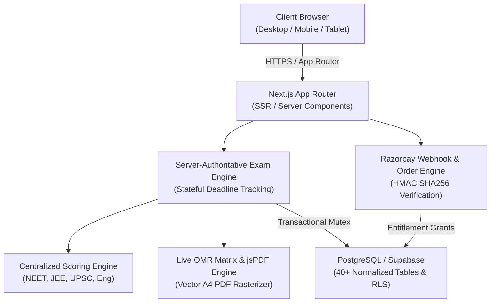
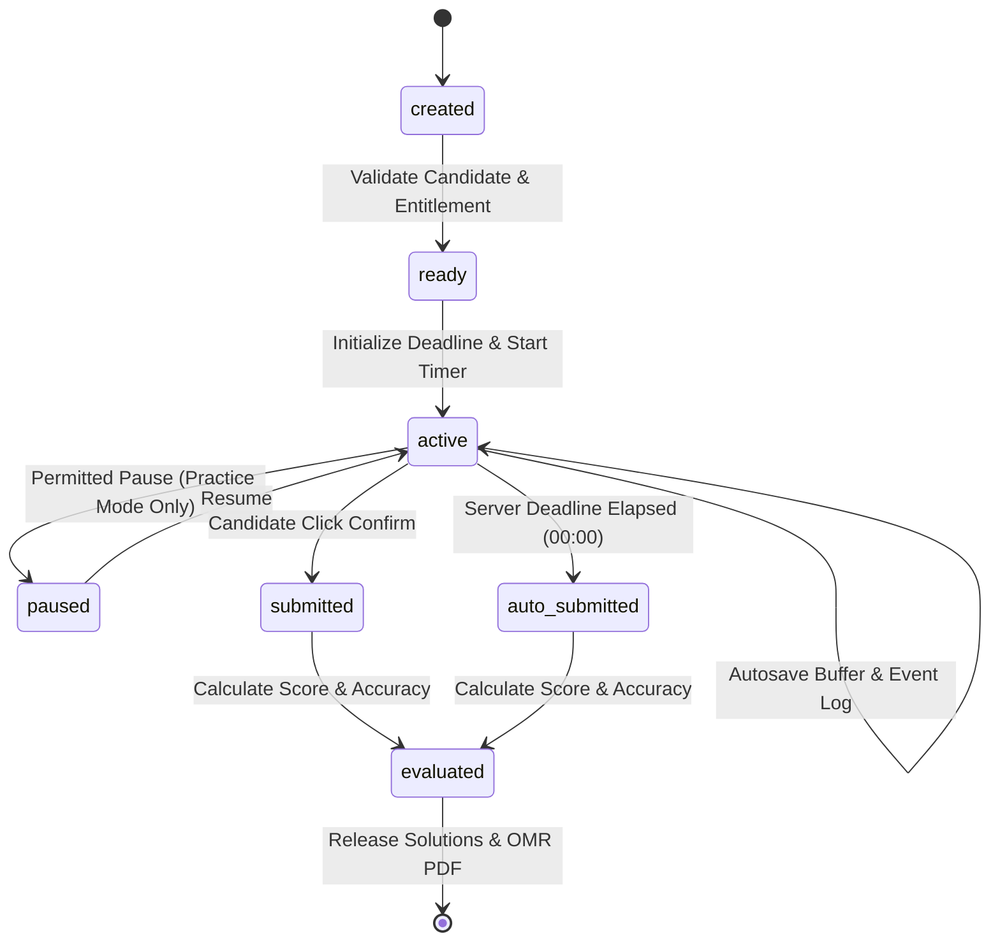

# FORT Learning — System Architecture & Design Documentation

## 1. System Topology

---

## 2. Examination Attempt Lifecycle State Machine

---

## 3. Security Boundary & Row Level Security

- **Client Trust Zero:** Clients never submit final scores, timer values, or correct answers.
- **Sealed Answer Keys:** Answer keys and solutions are filtered from client payloads during active tests.
- **PostgreSQL Row Level Security:** Every attempt, answer row, and payment record is partitioned strictly by `auth.uid() = student_id`.
- **Atomic Identification:** Candidate IDs (`FORT-26-XXXXXX`) are minted atomically through a dedicated database sequence.
